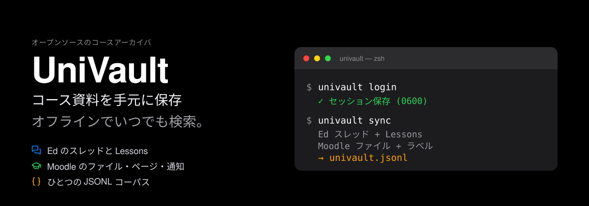
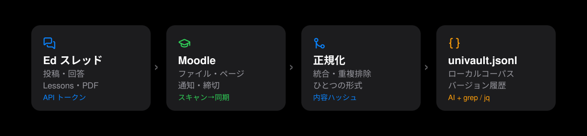

# UniVault

[English](README.md) | [中文](README.zh-CN.md) | **日本語** | [한국어](README.ko.md)

<p align="center">
  
</p>

<p align="center">
  
  
  
  
  
</p>

<p align="center">
  <b>Ed と Moodle のコース資料を、自分のパソコンへ。<br>
  コースごとに整理、オフラインで検索、削除された投稿にも負けない。</b>
</p>

---

## やさしいことばで：UniVault とは？

コース資料は **Moodle**（コースサイト）と **Ed**（ディスカッション）の
2 か所に分かれています。先生はスライド、PDF、お知らせ、課題の説明を置き、
クラスメートやチューターが Ed で質問に答えます。

でも、それは本当にあなたのものではありません。

- リンクはしばらくすると開けなくなる；
- 先生がスライドを差し替えたり、古いお知らせを消したりする；
- 大学がシステムを変えたり、卒業したりするとログインできなくなる；
- AI に復習を手伝ってほしくても、AI はその内容を読めない。

**UniVault は、あなたのパソコンの中に住む司書のようなものです。**
一度ログインを許すだけで、お知らせ、ファイル、ページ、ディスカッション、
レッスンのスライドを、あなたのフォルダにコピーして整理します。
資料には番号を振り、古い版も残します。

**読み取り専用**です。投稿、課題提出、資料の編集、権限のない内容への
アクセスは一切しません。

## どんな悩みを解決する？

| 困っていること | UniVault のやり方 |
|---|---|
| お知らせが埋もれて見落とす | コースと日付ごとに保存し、いつでも検索 |
| 先生がスライドを差し替えた | 古い版は `_history/` に残る |
| 復習のたびに複数のサイトを開く | 1 つのフォルダに全部そろう |
| 飛行機や図書館でネットがない | ファイルはすでに手元にある |
| AI がコース内容を読んでくれない | どの AI でも読める `univault.jsonl` を生成 |
| 卒業・買い替えで資料を失う | 普通のファイルなのでコピーすればよい |
| パスワードを渡すのが不安 | パスワードは保存せず、Cookie はローカルだけ |

## 何をアーカイブできる？

**Ed Discussion**

- スレッド、回答、ネストした返信
- Lessons ページ（本文を Markdown に変換）
- Lessons 内の PDF スライド

**Moodle**

- コースファイル：PDF、Word、PowerPoint、Excel、画像、圧縮ファイル
- ページ、ラベル、セクション概要
- お知らせ（添付ファイルと返信を含む）
- コース構造、週、アクティビティ一覧

**統合された出力**

- 各プラットフォームが JSONL ログを書き出す（1 行 1 レコード）
- `univault-normalize` が 2 つをプラットフォーム非依存の
  `univault.jsonl` に統合
- ダウンロードしたファイルには SHA-256 の指紋。変わっていなければ再ダウンロードしない

## 仕組み

<p align="center">
  
</p>

新しい家に引っ越すときと同じ、4 つのステップです。

1. **ログイン**：自分のアカウントで 1 回だけ。Okta と MFA（スマホの確認など）は
   自分で完了し、UniVault はパスワードを見ません。
2. **スキャン（scan）**：サイトを下見して、何があるか一覧にします。
   **この段階では 1 ファイルもダウンロードしません。**
3. **同期（sync）**：あなたが確認してから、ダウンロード・検証・保存を実行。
   コース全体でも 1 ファイルだけでも選べます。
4. **正規化（normalize）**：Ed と Moodle の記録を 1 つのカタログにまとめます。

### 難しい言葉を 4 つだけ、やさしく

- **指紋（SHA-256）**：ファイルごとの一意な「ID」。内容が同じなら再取得せず、
  壊れたダウンロードもすぐ分かります。
- **バージョン履歴**：先生がファイルを差し替えると、古い版は `_history/` へ。
  本棚に旧版を残して、新版を隣に置くイメージです。
- **クラッシュ復旧**：ダウンロード中に電源や Wi-Fi が切れても、journal が
  「どこまでやったか」を記録。次回は続きから安全に再開します。
- **Cookie（一時的な通行証）**：ログイン後にサイトが発行する一時的な通行証。
  UniVault は `0600` でローカルに保管し、アップロードも投稿・編集への利用もしません。

## UniVault を使う理由

必要なものだけどうぞ。

**なくさないため**

1. **リンクは死ぬが、アーカイブは残る。** 投稿が消え、コースが閉じても手元にある。
2. **「先生がまたスライドを変えた」に強い。** 旧版が自動で残り、比較も簡単。
3. **卒業後も持ち出せる。** 大学アカウントに縛られない普通のファイル。

**時間を節約するため**

4. **5 つのサイトを行き来しない。** コースと週ごとに 1 つのフォルダへ。
5. **スクロールより検索。** JSONL は `grep` や `jq`、どんな AI でも読める。
6. **差分同期。** 2 回目は新規・変更分だけを処理。
7. **見てからダウンロード。** `scan` は一覧だけ。ディスクを勝手に埋めない。

**安全とプライバシーのため**

8. **リモートは読み取り専用。** 投稿、提出、編集、隠しコンテンツなし。
9. **パスワードを保存しない。** ログインは自分で。UniVault はセッション
   Cookie だけを保持。
10. **Cookie はローカルだけ。** 権限 `0600`、ディレクトリ `0700`、アップロードなし。
11. **アーカイブを自動で掃除。** script、イベント属性、機密パラメータを除去。
    署名付きの一時ダウンロードリンクは保存しない。

**長く使うため**

12. **無料でオープンソース。** MIT ライセンス。読む、直す、監査するが自由。
13. **重い依存なし。** クロールは Python 標準ライブラリのみ。Playwright は
    任意のワンクリックログインだけ。
14. **ロックインなし。** ファイルはファイル、JSONL はテキスト。いつでも離れられる。
15. **どんなエージェントでも。** ZCode、Claude Code、Gemini CLI、Cursor、
    Codex……コマンドが動けば使えます。MCP サーバーは不要。

## こんな人に向いています

- **現役の学生**：お知らせを見落としたくない、復習でファイルを探したくない。
- **AI と一緒に学ぶ人**：ChatGPT/Claude に自分のコースを本当に読んでほしい。
- **卒業・買い替えの人**：数年間の資料を丸ごと持ち出したい。
- **チューター・先生**：自分がアクセス権を持つコースをバックアップしたい。
- **プラットフォームに縛られたくない人**：資料は自分の手元にあるべきだと思う。

## 5 分で始める

プログラマーである必要はありません。**コピー＆ペーストして Enter** だけです。

**用意するもの**：macOS または Linux（Windows でも動きますが、ワンクリック
ログインは主に macOS で検証）、Python 3.10+、Git。

### 1. インストール

```bash
git clone https://github.com/hbpencilw/univault.git
cd univault
./install.sh
export PATH="$HOME/.local/bin:$PATH"
univault --help
```

何が書き込まれるか先に見たいときは `./install.sh --dry-run`。

### 2. Moodle にログイン（どちらか）

```bash
univault login
```

専用の Edge ウィンドウが開きます。いつもどおり Okta と MFA を完了してください。
UniVault は Moodle のセッション Cookie だけをローカルに保存します。

または Cookie を手動でインポート：

```bash
moodle-setup import-cookie --from-clipboard
```

### 3. まずスキャン、ダウンロードはしない

```bash
univault sync --dry-run
```

履修中のコース、ファイル、これから何が起きるかを表示します。
**この段階では何もダウンロードしません。**

### 4. 1 コースをアーカイブ

```bash
univault sync --course UNIT1001
```

`UNIT1001` を自分のコースコードに置き換えてください。履修中の全コースなら
`univault sync` だけです。設定にこの科目の Ed コース ID があれば、この手順で
Ed も更新されます。なければ次の手順で個別に実行してください。

### 5. Ed のスレッドと Lessons をアーカイブ

```bash
ed-archive UNIT1001 10001 ~/courses/2026_s2/unit1001/memory/resources/ed
ed-lessons UNIT1001 10001 ~/courses/2026_s2/unit1001/memory/resources/ed
```

`10001` は Ed の URL にあるコース ID です。Ed には個人用 API トークン
（`~/.config/edstem-cli/token`、`ed-setup` が作成）が必要です。

### 6. 統合コーパスを作る

```bash
univault-normalize ~/courses/2026_s2/unit1001/memory/resources/moodle \
  -o ~/courses/2026_s2/unit1001/memory/resources/univault.jsonl
```

これで完了。Wi-Fi を切ってフォルダを開いても、AI に `univault.jsonl` を
読ませてもかまいません。

## アーカイブの構成

```
<course>/memory/resources/
├── ed/                 threads.jsonl · ed_discussions.md
│                       lessons.jsonl · ed_lessons.md · lesson_files/
├── moodle/             moodle.jsonl · resources/ · pages/ · sections/ · announcements/
│                       _history/<logical_id>/<sha>.<ext>
│                       _state/journal.jsonl · _reports/sync-*.md
└── univault.jsonl      統合コーパス（Ed + Moodle）
```

- `resources/`：ダウンロードしたコースファイル
- `pages/`、`sections/`：ページとセクション内容
- `announcements/`：お知らせ
- `_history/`：旧版（自動削除なし）
- `_reports/`：同期ごとのレポート

## セキュリティとプライバシー（やさしいことばで）

- **リモートは読み取り専用**：投稿、提出、編集、権限回避なし。
- **パスワードを保存しない**：ログインと MFA はブラウザで自分が完了。
- **Cookie はローカルだけ**：`~/.config/univault/moodle-cookie`、`0600`、
  ディレクトリ `0700`。
- **アップロードなし**：クラウドもテレメトリもなし。すべて手元のディスク。
- **隠しコンテンツなし**：見えないものは取得しません。
- **アーカイブは自分で管理**：著作権物や個人情報を含む可能性があります。
  公開・共有しないでください。

## よくある質問

**プログラミングは必要？**
いいえ。インストールも実行もコピー＆ペーストです。分からないところは
AI アシスタントに聞いてください。

**大学の規則に違反しない？**
UniVault は**自分がアクセス権を持つ**内容だけを、読み取り専用で保存します。
それでも大学の利用規約に従ってください。著作権物や個人情報を含むファイルを
再配布してはいけません。

**先生が消したお知らせは取り戻せる？**
アーカイブ済みなら `_history/` や JSONL の履歴に残っています。未取得なら
無理です。早く始めるほど安心です。

**ディスクを圧迫しない？**
`scan` はダウンロードせず、`sync` も選んだコースだけ。`--max-mb` で
ファイルサイズを制限できます。1 コースは通常数十〜数百 MB です。

**Canvas には対応している？**
今は Monash の Moodle + Ed が中心で、Canvas は未実装です。設計には
拡張の余地がありますが、「予定」を「使える」とは言いません。

**Windows でも動く？**
コマンドラインは動きます。ワンクリック Edge ログインは主に macOS で検証
済みです。Windows では Cookie の手動インポートを使ってください。

**クラウドに同期される？**
いいえ。サーバーはありません。指定したローカルフォルダにだけ書き込みます。

## 開発者向け

- **111 件のオフラインテスト**：認証、URL/リダイレクト安全性、HTML
  サニタイズ、バージョン管理、クラッシュ復旧、冪等性、両 CLI。
- **アーキテクチャ**：[docs/ARCHITECTURE.md](docs/ARCHITECTURE.md)
- **エージェント統合**：[docs/AGENT_INTEGRATION.md](docs/AGENT_INTEGRATION.md)
- **サードパーティライセンス**：[docs/THIRD_PARTY.md](docs/THIRD_PARTY.md)

テスト：

```bash
python3 -m unittest discover -s tests/moodle
```

### あらゆるエージェントで利用可能

UniVault は CLI ファーストです。`AGENTS.md` が共通の入口で、`CLAUDE.md`、
`GEMINI.md`、Cursor ルール、`CONVENTIONS.md` が各環境向けの補足を提供します。
MCP サーバーは不要です。

### ZCode プラグイン

リポジトリのルートがプラグインです。**Plugin Marketplace → Add → Add Plugin
Marketplace** に `https://github.com/hbpencilw/univault` を貼り付け（ローカル
開発ではリポジトリのパスでも可）、**UniVault** をインストールすると、
`univault`、`univault-ed`、`univault-moodle` の skill が選択できます。

以前のローカル `dev-univault` マーケットを追加している場合は、重複を避けるため
先に削除してください。プラグインは Agent skill のみを提供します。CLI は上の
インストール手順で `./install.sh` を一度実行してください。

### 設定

任意の `~/.config/univault/config.json`：

```json
{
  "learning_root": "~/courses",
  "ed_units": { "UNIT1001": 10001 }
}
```

`UNIVAULT_LEARNING_ROOT` と `UNIVAULT_CONFIG` で上書きできます。

## ライセンス

MIT（[LICENSE](LICENSE)）。サードパーティの参考プロジェクトとライセンスは
[docs/THIRD_PARTY.md](docs/THIRD_PARTY.md) に記載。GPL/AGPL/PolyForm の
ソースは同梱していません。
