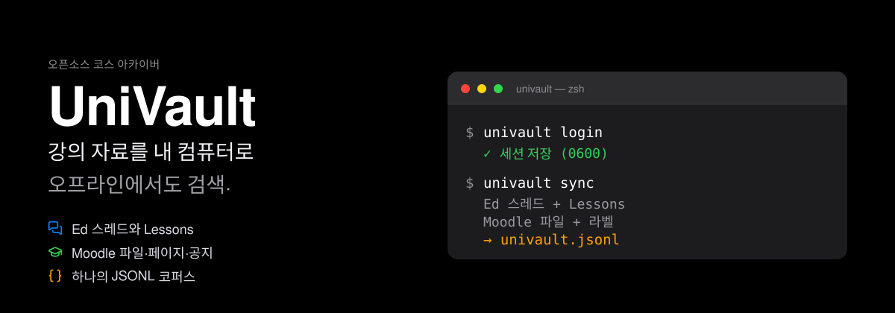
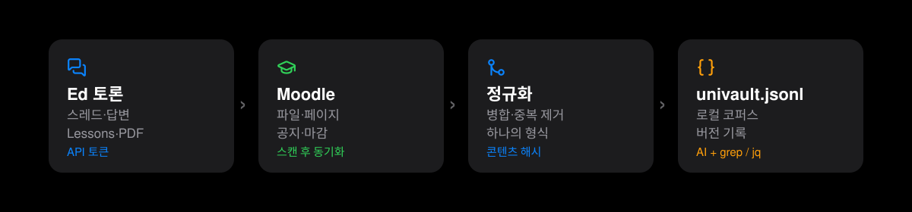

# UniVault

[English](README.md) | [中文](README.zh-CN.md) | [日本語](README.ja.md) | **한국어**

<p align="center">
  
</p>

<p align="center">
  
  
  
  
  
</p>

<p align="center">
  <b>Ed와 Moodle의 강의 자료를 내 컴퓨터로.<br>
  과목별로 정리하고, 오프라인에서 검색하고, 삭제된 공지에도 끄떡없이.</b>
</p>

---

## 쉬운 말로: UniVault란?

강의 자료는 두 곳에 나뉘어 있습니다. **Moodle**(과목 사이트)과 **Ed**(토론
게시판)입니다. 교수님은 슬라이드, PDF, 공지, 과제 안내를 올리고, 동기와
튜터는 Ed에서 질문에 답합니다.

그런데 그 자료는 온전히 내 것이 아닙니다.

- 링크는 시간이 지나면 열리지 않습니다.
- 교수님이 슬라이드를 바꾸거나 예전 공지를 삭제합니다.
- 학교 시스템이 바뀌거나 졸업하면 로그인이 막힙니다.
- AI에게 복습을 맡기고 싶어도 AI는 이 내용을 읽지 못합니다.

**UniVault는 내 컴퓨터에 사는 사서와 같습니다.** 한 번 로그인을 허락하면,
공지, 파일, 페이지, 토론 글, 레슨 슬라이드를 내 폴더로 복사해 정리합니다.
자료마다 번호를 붙이고 예전 버전도 남겨 둡니다.

**읽기 전용**입니다. 게시, 과제 제출, 자료 수정, 권한 밖의 접근은 하지
않습니다.

## 어떤 문제를 해결하나요?

| 겪는 문제 | UniVault의 방식 |
|---|---|
| 공지가 묻혀서 놓침 | 과목·날짜별로 저장하고 언제든 검색 |
| 교수님이 슬라이드를 교체함 | 예전 버전은 `_history/`에 영구 보관 |
| 복습할 때 여러 사이트를 오감 | 폴더 하나에 전부 정리 |
| 비행기·도서관에서 인터넷이 없음 | 파일이 이미 내 컴퓨터에 있음 |
| AI가 내 강의를 읽지 못함 | 어떤 AI든 읽는 `univault.jsonl` 생성 |
| 졸업·노트북 교체로 자료 상실 | 평범한 파일이라 그대로 복사 가능 |
| 비밀번호를 넘기는 게 불안 | 비밀번호는 저장하지 않고 쿠키는 로컬에만 |

## 무엇을 아카이브할 수 있나요?

**Ed Discussion**

- 스레드, 답변, 중첩 답글
- Lessons 페이지(본문을 Markdown으로 변환)
- Lessons 안의 PDF 슬라이드

**Moodle**

- 과목 파일: PDF, Word, PowerPoint, Excel, 이미지, 압축 파일
- 페이지, 라벨, 섹션 요약
- 공지(첨부 파일과 답글 포함)
- 과목 구조, 주차, 활동 목록

**통합 출력**

- 플랫폼마다 JSONL 로그를 기록(한 줄에 한 레코드)
- `univault-normalize`가 둘을 플랫폼 독립적인 `univault.jsonl`로 병합
- 내려받은 파일에는 SHA-256 지문. 내용이 같으면 다시 받지 않음

## 작동 방식

<p align="center">
  
</p>

이사할 때처럼 네 단계입니다.

1. **로그인**: 내 계정으로 한 번. Okta와 MFA(휴대폰 확인 등)는 직접 완료하고,
   UniVault는 비밀번호를 보지 않습니다.
2. **스캔(scan)**: 사이트를 둘러보고 무엇이 있는지 목록만 만듭니다.
   **이 단계에서는 파일을 하나도 받지 않습니다.**
3. **동기화(sync)**: 내가 확인한 뒤에야 다운로드·검증·저장을 실행합니다.
   과목 전체 또는 파일 하나만 고를 수 있습니다.
4. **정규화(normalize)**: Ed와 Moodle 기록을 하나의 카탈로그로 합칩니다.

### 어려운 말 네 개만 쉽게

- **지문(SHA-256)**: 파일마다 붙는 고유 ID. 내용이 같으면 다시 받지 않고,
  다운로드가 깨지면 바로 알 수 있습니다.
- **버전 기록**: 교수님이 파일을 바꾸면 예전 버전은 `_history/`로 이동합니다.
  책장에 구판을 두고 신판을 옆에 놓는 것과 같습니다.
- **중단 복구**: 다운로드 중 전원이나 Wi-Fi가 끊겨도 journal이 어디까지
  했는지 기록합니다. 다음 실행에서 안전하게 이어서 마무리합니다.
- **쿠키(Cookie, 임시 출입증)**: 로그인 후 사이트가 발급하는 임시 출입증.
  UniVault는 `0600`으로 로컬에 보관하고, 업로드하거나 게시·수정에 쓰지 않습니다.

## UniVault를 쓰는 이유

필요한 이유만 골라 보세요.

**잃지 않기 위해**

1. **링크는 죽어도 아카이브는 남습니다.** 글이 삭제되고 과목이 닫혀도 내게 있습니다.
2. **"교수님이 또 슬라이드를 바꿨다"에 강합니다.** 예전 버전이 자동으로 남아 비교가 쉽습니다.
3. **졸업 후에도 가지고 갈 수 있습니다.** 학교 계정에 묶이지 않는 평범한 파일입니다.

**시간을 아끼기 위해**

4. **다섯 사이트를 오가지 않습니다.** 과목과 주차별로 폴더 하나에 정리.
5. **스크롤보다 검색.** JSONL은 `grep`, `jq`, 어떤 AI든 읽을 수 있습니다.
6. **증분 동기화.** 두 번째 실행은 새로 생기거나 바뀐 것만 처리합니다.
7. **보고 받기.** `scan`은 목록만 만들고 디스크를 채우지 않습니다.

**안전과 개인정보를 위해**

8. **원격은 읽기 전용.** 게시, 제출, 수정, 숨김 콘텐츠 접근 없음.
9. **비밀번호를 저장하지 않습니다.** 로그인은 직접 하고, UniVault는 세션
   쿠키만 보관합니다.
10. **쿠키는 로컬에만.** 권한 `0600`, 디렉터리 `0700`, 업로드 없음.
11. **아카이브 자동 정리.** script, 이벤트 속성, 민감한 파라미터를 제거하고
    서명된 임시 다운로드 링크는 저장하지 않습니다.

**오래 쓰기 위해**

12. **무료 오픈소스.** MIT 라이선스. 읽고, 고치고, 감사할 수 있습니다.
13. **무거운 의존성 없음.** 크롤링은 Python 표준 라이브러리만. Playwright는
    선택 사항인 원클릭 로그인에만 사용.
14. **락인 없음.** 파일은 파일이고 JSONL은 텍스트입니다. 언제든 떠날 수 있습니다.
15. **모든 에이전트와 호환.** ZCode, Claude Code, Gemini CLI, Cursor, Codex……
    명령을 실행할 수 있으면 됩니다. MCP 서버는 필요 없습니다.

## 이런 사람에게 맞습니다

- **현역 학생**: 공지를 놓치기 싫고, 복습할 때 파일을 찾고 싶지 않은 사람.
- **AI와 함께 공부하는 사람**: ChatGPT/Claude가 내 강의를 진짜로 읽길 바라는 사람.
- **졸업·노트북 교체 예정자**: 몇 년치 자료를 통째로 가져가고 싶은 사람.
- **튜터·교수**: 자신이 접근 권한을 가진 과목을 백업하고 싶은 사람.
- **플랫폼에 묶이고 싶지 않은 사람**: 자료는 내 손에 있어야 한다고 믿는 사람.

## 5분 만에 시작하기

프로그래머일 필요는 없습니다. **복사해서 붙여넣고 Enter**만 누르면 됩니다.

**준비물**: macOS 또는 Linux(Windows도 되지만 원클릭 로그인은 주로 macOS에서
검증), Python 3.10+, Git.

### 1. 설치

```bash
git clone https://github.com/hbpencilw/univault.git
cd univault
./install.sh
export PATH="$HOME/.local/bin:$PATH"
univault --help
```

무엇이 설치될지 먼저 보려면 `./install.sh --dry-run`.

### 2. Moodle 로그인(택 1)

```bash
univault login
```

전용 Edge 창이 열립니다. 평소처럼 Okta와 MFA를 완료하세요. UniVault는
Moodle 세션 쿠키만 로컬에 저장합니다.

또는 쿠키를 직접 가져오기:

```bash
moodle-setup import-cookie --from-clipboard
```

### 3. 먼저 스캔, 다운로드는 하지 않음

```bash
univault sync --dry-run
```

수강 중인 과목, 파일, 앞으로 일어날 일을 보여 줍니다.
**이 단계에서는 아무것도 다운로드하지 않습니다.**

### 4. 과목 하나 아카이브

```bash
univault sync --course UNIT1001
```

`UNIT1001`을 내 과목 코드로 바꾸세요. 수강 중인 모든 과목은
`univault sync`만 실행하면 됩니다. 설정에 이 과목의 Ed 코스 ID가 있으면 이
단계에서 Ed도 업데이트됩니다. 없으면 다음 단계에서 따로 실행하세요.

### 5. Ed 스레드와 Lessons 아카이브

```bash
ed-archive UNIT1001 10001 ~/courses/2026_s2/unit1001/memory/resources/ed
ed-lessons UNIT1001 10001 ~/courses/2026_s2/unit1001/memory/resources/ed
```

`10001`은 Ed URL에 있는 과목 ID입니다. Ed에는 개인 API 토큰
(`~/.config/edstem-cli/token`, `ed-setup`이 생성)이 필요합니다.

### 6. 통합 코퍼스 만들기

```bash
univault-normalize ~/courses/2026_s2/unit1001/memory/resources/moodle \
  -o ~/courses/2026_s2/unit1001/memory/resources/univault.jsonl
```

끝났습니다. Wi-Fi를 끄고 폴더를 열어도 되고, AI에게 `univault.jsonl`을
읽게 해도 됩니다.

## 아카이브 구조

```
<course>/memory/resources/
├── ed/                 threads.jsonl · ed_discussions.md
│                       lessons.jsonl · ed_lessons.md · lesson_files/
├── moodle/             moodle.jsonl · resources/ · pages/ · sections/ · announcements/
│                       _history/<logical_id>/<sha>.<ext>
│                       _state/journal.jsonl · _reports/sync-*.md
└── univault.jsonl      통합 코퍼스 (Ed + Moodle)
```

- `resources/`: 내려받은 과목 파일
- `pages/`, `sections/`: 페이지와 섹션 내용
- `announcements/`: 공지
- `_history/`: 예전 버전(자동 삭제 없음)
- `_reports/`: 동기화마다 생성되는 보고서

## 보안과 개인정보(쉬운 말로)

- **원격은 읽기 전용**: 게시, 제출, 수정, 권한 우회 없음.
- **비밀번호를 저장하지 않음**: 로그인과 MFA는 브라우저에서 직접.
- **쿠키는 로컬에만**: `~/.config/univault/moodle-cookie`, `0600`,
  디렉터리 `0700`.
- **업로드 없음**: 클라우드도 텔레메트리도 없습니다. 모든 것은 내 디스크.
- **숨김 콘텐츠 없음**: 볼 수 없는 것은 가져오지 않습니다.
- **아카이브는 직접 관리**: 저작권 자료와 개인정보가 들어 있을 수 있습니다.
  공개하거나 공유하지 마세요.

## 자주 묻는 질문

**프로그래밍을 알아야 하나요?**
아니요. 설치와 실행은 복사·붙여넣기입니다. 이해가 안 되면 AI 어시스턴트에게
물어보세요.

**학교 규정을 위반하나요?**
UniVault는 **내가 접근 권한을 가진** 내용만 읽기 전용으로 저장합니다.
그래도 학교 이용 약관을 지키세요. 저작권 자료나 개인정보가 든 파일을
재배포하면 안 됩니다.

**교수님이 삭제한 공지를 되살릴 수 있나요?**
아카이브했다면 `_history/`나 JSONL 기록에 남아 있습니다. 안 했다면 불가능합니다.
일찍 시작할수록 좋습니다.

**디스크를 많이 차지하나요?**
`scan`은 다운로드하지 않고, `sync`도 선택한 과목만 받습니다. `--max-mb`로
파일 크기를 제한할 수 있습니다. 보통 과목당 수십~수백 MB입니다.

**Canvas도 지원하나요?**
아직 아닙니다. 현재는 Monash의 Moodle + Ed에 집중하고 있습니다. 구조에는
확장 여지가 있지만, "계획"을 "사용 가능"이라고 말하지는 않습니다.

**Windows에서도 되나요?**
명령줄은 동작합니다. 원클릭 Edge 로그인은 주로 macOS에서 검증했습니다.
Windows에서는 쿠키를 직접 가져오세요.

**클라우드로 동기화되나요?**
아니요. 서버가 없습니다. 지정한 로컬 폴더에만 씁니다.

## 개발자용

- **111개 오프라인 테스트**: 인증, URL/리다이렉트 안전성, HTML 정리,
  버전 관리, 중단 복구, 멱등성, 두 CLI.
- **아키텍처**: [docs/ARCHITECTURE.md](docs/ARCHITECTURE.md)
- **에이전트 통합**: [docs/AGENT_INTEGRATION.md](docs/AGENT_INTEGRATION.md)
- **서드파티 라이선스**: [docs/THIRD_PARTY.md](docs/THIRD_PARTY.md)

테스트:

```bash
python3 -m unittest discover -s tests/moodle
```

### 모든 에이전트와 호환

UniVault는 CLI 우선입니다. `AGENTS.md`가 공통 진입점이며, `CLAUDE.md`,
`GEMINI.md`, Cursor 규칙, `CONVENTIONS.md`가 환경별 안내를 제공합니다.
MCP 서버는 필요하지 않습니다.

### ZCode 플러그인

저장소 루트가 플러그인입니다. **Plugin Marketplace → Add → Add Plugin
Marketplace**에 `https://github.com/hbpencilw/univault`를 붙여넣고(로컬 개발
시에는 저장소 경로도 가능), **UniVault**를 설치하면 `univault`,
`univault-ed`, `univault-moodle` 스킬을 선택할 수 있습니다.

이전에 로컬 `dev-univault` 마켓을 추가했다면 중복 플러그인 ID를 피하기 위해
먼저 제거하세요. 플러그인은 Agent skill만 제공합니다. CLI는 위 설치 단계에서
`./install.sh`를 한 번 실행해야 합니다.

### 설정

선택적 `~/.config/univault/config.json`:

```json
{
  "learning_root": "~/courses",
  "ed_units": { "UNIT1001": 10001 }
}
```

`UNIVAULT_LEARNING_ROOT`와 `UNIVAULT_CONFIG`로 재정의할 수 있습니다.

## 라이선스

MIT — [LICENSE](LICENSE) 참조. 서드파티 참고 프로젝트와 라이선스는
[docs/THIRD_PARTY.md](docs/THIRD_PARTY.md)에 있습니다. GPL/AGPL/PolyForm
소스는 포함하지 않습니다.
