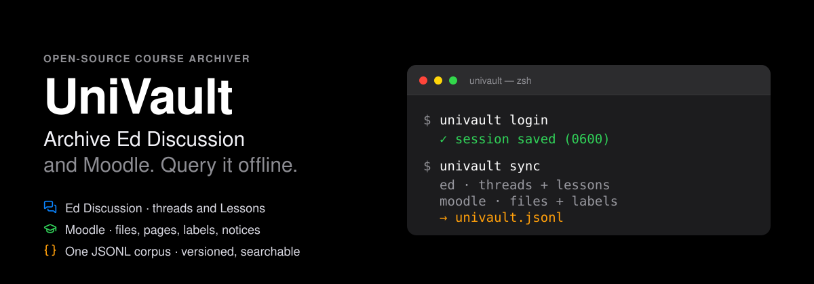
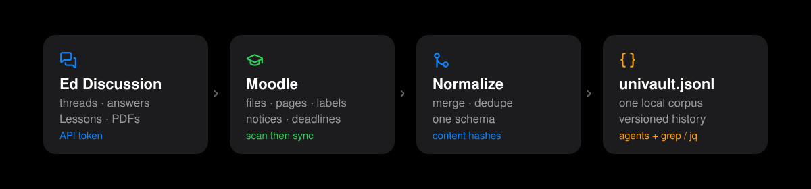

# UniVault

**English** | [中文](README.zh-CN.md) | [日本語](README.ja.md) | [한국어](README.ko.md)

<p align="center">
  
</p>

<p align="center">
  
  
  
  
  
</p>

<p align="center">
  <b>Bring your Ed and Moodle course material home.<br>
  Organised by course, searchable offline, safe from deleted posts.</b>
</p>

---

## What is UniVault, in plain words?

Your course material lives in two places: **Moodle** (the course site) and **Ed**
(the discussion forum). Teachers put slides, PDFs, announcements and assignment
briefs there; classmates and tutors answer questions on Ed.

But none of it really belongs to you:

- Links stop working after a while;
- Teachers edit slides or delete old announcements;
- The university changes systems, or you graduate, and the login stops working;
- You want an AI to help you revise, but it cannot see any of this.

**UniVault is like a librarian who lives on your computer.** You let it log in
once, and it copies what you ask for — announcements, files, pages, discussion
threads, lesson slides — into folders on your disk. It labels everything and
keeps old versions.

It is **read-only**: it never posts, submits assignments, edits course content,
or bypasses anything you are not allowed to see.

## What it takes off your plate

| The problem | What UniVault does |
|---|---|
| Announcements get buried | Every announcement stored by course and date, searchable |
| A teacher replaces the slides | The old version stays in `_history/` forever |
| Revision means opening five websites | One archive, one folder, everything in place |
| No internet on the plane | Files are already on your disk |
| Your AI has never read your course | A single `univault.jsonl` any agent can read |
| Graduating means losing access | Plain files you can copy anywhere |
| Worried about handing over your password | No password stored, cookie stays local, remote is read-only |

## What it can archive

**Ed Discussion**

- Threads, answers and nested replies
- Lessons pages (body converted to Markdown)
- PDF slides inside Lessons

**Moodle**

- Course files: PDF, Word, PowerPoint, Excel, images, archives
- Pages, labels and section summaries
- Announcements, including attachments and replies
- Course structure, weeks and activity lists

**One unified output**

- Each platform writes its own JSONL log (one record per line)
- `univault-normalize` merges both into a platform-agnostic `univault.jsonl`
- Every downloaded file gets a SHA-256 fingerprint, so unchanged files are never downloaded twice

## How it works

<p align="center">
  
</p>

Four steps, like moving into a new home:

1. **Log in** once with your own account. You complete Okta and MFA (for
   example, a phone prompt) yourself; UniVault never sees your password.
2. **Scan** the site and list what exists. **Nothing is downloaded at this step.**
3. **Sync** only after you confirm. Archive a whole course or a single file.
4. **Normalize** both platforms into one catalogue.

### A few technical words, explained simply

- **Fingerprint (SHA-256):** a unique ID for each file. If the content has not
  changed, it is not downloaded again; if a download is corrupt, you find out.
- **Version history:** when a teacher replaces a file, the old one moves to
  `_history/` and the new one takes its place. Like keeping the old edition of a
  textbook on the shelf.
- **Crash recovery:** if the power or Wi-Fi dies mid-download, a journal records
  what was in progress. The next run finishes the job without corrupting files
  you already have.
- **Cookie (a temporary pass):** after login the site gives your browser a
  temporary pass. UniVault keeps it on your machine with mode `0600`, never
  uploads it, and never uses it to post or edit anything.

## Why use UniVault?

Pick the reasons that matter to you.

**So you never lose material**

1. **Links die; archives do not.** Once archived, it survives deleted posts and
   closed courses.
2. **Built for “the teacher changed the slides again”.** Old versions are kept
   automatically, which makes comparison easy.
3. **Take it with you after graduation.** These are ordinary files, not data
   locked inside a university account.

**To save time**

4. **Stop clicking between five websites.** One folder, organised by course and week.
5. **Search beats scrolling.** JSONL works with `grep` and `jq`, and any AI can read it.
6. **Incremental sync.** The second run only handles new or changed material.
7. **Look before you download.** `scan` lists everything and fills none of your disk.

**For safety and privacy**

8. **Remote is read-only.** No posts, submissions, edits, or hidden content.
9. **No stored password.** You log in yourself; UniVault keeps only a session cookie.
10. **Cookie stays on your machine.** File mode `0600`, directory `0700`, no upload.
11. **Clean archives.** Saved HTML drops scripts, event handlers and sensitive
    parameters; temporary signed download links are never stored.

**For the long run**

12. **Free and open source.** MIT licence: inspect it, modify it, audit it.
13. **No heavy stack.** Crawling uses the Python standard library; Playwright is
    optional and only powers the one-click login.
14. **No lock-in.** Files are files and JSONL is text; you can walk away any time.
15. **Works with any agent.** ZCode, Claude Code, Gemini CLI, Cursor, Codex —
    anything that can run a command, with no MCP server required.

## Who it is for

- **Students** who do not want to miss an announcement or hunt for files.
- **AI-assisted learners** who want ChatGPT/Claude to actually read their course.
- **Graduating students and laptop upgraders** who want to keep years of material.
- **Tutors and teachers** backing up content they already have access to.
- **Anyone tired of platform lock-in** who believes material should live on their
  own disk.

## Quick start

You do not need to be a programmer. You need to copy, paste and press Enter.

**Requirements:** macOS or Linux (Windows works, but the one-click login is
primarily tested on macOS), Python 3.10+, and Git.

### 1. Install

```bash
git clone https://github.com/hbpencilw/univault.git
cd univault
./install.sh
export PATH="$HOME/.local/bin:$PATH"
univault --help
```

Want to see what it would do first? `./install.sh --dry-run` previews without
writing anything.

### 2. Log in to Moodle (choose one)

```bash
univault login
```

A dedicated Edge window opens. Complete Okta and MFA as usual; UniVault saves
only the Moodle session cookie on your machine.

Or import a cookie manually:

```bash
moodle-setup import-cookie --from-clipboard
```

### 3. Scan first, download nothing

```bash
univault sync --dry-run
```

It shows which courses are enrolled, what files exist and what would happen.
**This step downloads nothing.**

### 4. Archive one course

```bash
univault sync --course UNIT1001
```

Replace `UNIT1001` with your course code. To archive every enrolled course,
just run `univault sync`. If your config maps this unit to an Ed course ID, this
step also updates Ed; otherwise continue to step 5.

### 5. Archive Ed threads and Lessons

```bash
ed-archive UNIT1001 10001 ~/courses/2026_s2/unit1001/memory/resources/ed
ed-lessons UNIT1001 10001 ~/courses/2026_s2/unit1001/memory/resources/ed
```

`10001` is the Ed course ID from the Ed URL. Ed needs a personal API token at
`~/.config/edstem-cli/token`, created by `ed-setup`.

### 6. Build the unified corpus

```bash
univault-normalize ~/courses/2026_s2/unit1001/memory/resources/moodle \
  -o ~/courses/2026_s2/unit1001/memory/resources/univault.jsonl
```

Done. Turn off Wi-Fi, open the folder, or point an AI at `univault.jsonl`.

## What you get

```
<course>/memory/resources/
├── ed/                 threads.jsonl · ed_discussions.md
│                       lessons.jsonl · ed_lessons.md · lesson_files/
├── moodle/             moodle.jsonl · resources/ · pages/ · sections/ · announcements/
│                       _history/<logical_id>/<sha>.<ext>
│                       _state/journal.jsonl · _reports/sync-*.md
└── univault.jsonl      unified corpus (Ed + Moodle)
```

- `resources/`: downloaded course files
- `pages/`, `sections/`: pages and section content
- `announcements/`: announcements
- `_history/`: superseded versions, never deleted automatically
- `_reports/`: a report for every sync

## Security and privacy, in plain words

- **Read-only remote:** no posts, submissions, edits, or permission bypasses.
- **No password stored:** you complete login and MFA in the browser.
- **Cookie stays local:** `~/.config/univault/moodle-cookie`, mode `0600`,
  directory `0700`.
- **No upload:** no cloud service, no telemetry; everything stays on your disk.
- **No hidden content:** if you cannot see it, UniVault does not fetch it.
- **Guard your archive:** it may contain copyrighted material and personal
  information. Do not publish or share it.

## FAQ

**Do I need to code?**
No. Install and run are copy-paste commands. Ask an AI assistant to explain
anything unclear.

**Could this break university rules?**
UniVault archives only content you already have permission to access, and it is
read-only. Still follow your university's terms: do not redistribute
copyrighted material or files containing personal information.

**A teacher deleted an announcement. Can I get it back?**
If you archived it, yes — check `_history/` and the JSONL history. If you never
archived it, no. That is why starting early helps.

**Will it fill my disk?**
`scan` downloads nothing, and `sync` only fetches the courses you choose.
`--max-mb` caps individual files. A course is usually tens to hundreds of MB,
depending on how many videos and archives the teacher posts.

**Does it support Canvas?**
Not yet. The current focus is Monash Moodle + Ed. The architecture leaves room
for other platforms, but “planned” is not “working”.

**Does it work on Windows?**
The command-line tools run; the one-click Edge login is primarily verified on
macOS. On Windows, use manual cookie import.

**Does it sync to the cloud?**
No. There is no server. Everything is written to the local folder you choose.

## For developers

- **111 offline tests** cover auth, URL/redirect safety, HTML sanitising,
  versioning, crash recovery, idempotency and both CLIs — no network required.
- **Architecture:** [docs/ARCHITECTURE.md](docs/ARCHITECTURE.md)
- **Agent integration:** [docs/AGENT_INTEGRATION.md](docs/AGENT_INTEGRATION.md)
- **Third-party licences:** [docs/THIRD_PARTY.md](docs/THIRD_PARTY.md)

Run the tests:

```bash
python3 -m unittest discover -s tests/moodle
```

### Works with any agent

UniVault is CLI-first. `AGENTS.md` is the universal briefing; `CLAUDE.md`,
`GEMINI.md`, the Cursor rule and `CONVENTIONS.md` add platform notes. No MCP
server is required.

### ZCode plugin

The repository root is the plugin. In **Plugin Marketplace → Add → Add Plugin
Marketplace**, paste `https://github.com/hbpencilw/univault` (a local repo path
also works for development), then install **UniVault** — the skills `univault`,
`univault-ed` and `univault-moodle` become available in the composer.

If you previously added the old local `dev-univault` market, remove it first to
avoid a duplicate plugin ID. The plugin provides Agent skills only; the CLI
still needs the `./install.sh` step above.

### Configuration

Optional `~/.config/univault/config.json`:

```json
{
  "learning_root": "~/courses",
  "ed_units": { "UNIT1001": 10001 }
}
```

`UNIVAULT_LEARNING_ROOT` and `UNIVAULT_CONFIG` override it.

## License

MIT — see [LICENSE](LICENSE). Third-party references and licences are listed
in [docs/THIRD_PARTY.md](docs/THIRD_PARTY.md); no GPL/AGPL/PolyForm source is
vendored.
