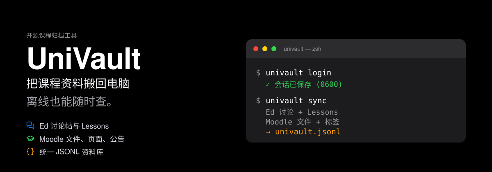
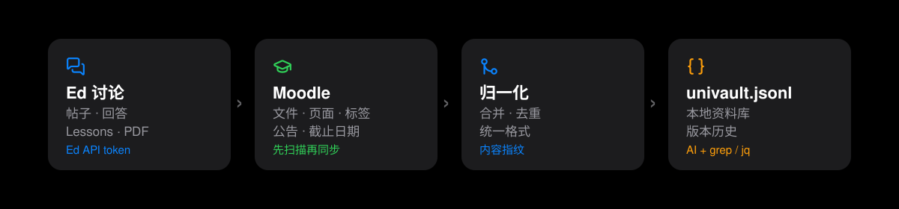

# UniVault

[English](README.md) | **中文** | [日本語](README.ja.md) | [한국어](README.ko.md)

<p align="center">
  
</p>

<p align="center">
  
  
  
  
  
</p>

<p align="center">
  <b>把 Ed 和 Moodle 上的课程资料，自动搬回你自己的电脑。<br>
  按课程整理好，断网也能查，老师删了也不怕。</b>
</p>

---

## 先说人话：UniVault 是什么？

想象一下：你的课程资料分散在两个地方——**Moodle**（课程主页）和 **Ed**（讨论区）。
老师把课件、PDF、公告、作业说明放在上面，同学和老师在 Ed 上讨论问题。

但这些东西并不真正属于你：

- 有些链接过一段时间就打不开了；
- 老师可能修改课件，甚至删掉旧公告；
- 学校系统一改版，或者你毕业了，账号就进不去了；
- 你想让 AI 帮你复习，AI 却看不到这些内容。

**UniVault 就像一个住在你电脑里的图书管理员。**
你给它一次登录机会，它按你的吩咐去这些网站“看”和“抄”，把公告、文件、网页、
讨论帖、老师上传的课件，分门别类放进你电脑的文件夹，还给每份资料编号、记录版本。

它**只读**：不会替你发帖、交作业、改资料，也不会绕过你本来就没有权限看的内容。

## 它替你解决哪些麻烦？

| 你遇到的麻烦 | UniVault 的做法 |
|---|---|
| 公告太多，翻着翻着就漏了 | 所有公告按课程、时间存好，随时搜 |
| 老师改了课件，旧版找不回来 | 旧版本自动进 `_history/`，永远留一份 |
| 复习时要开 Moodle、Ed 好几个网站 | 一条命令归档，一个文件夹全都有 |
| 飞机上/图书馆没网，资料打不开 | 文件已经在你电脑里，离线可看 |
| 想用 AI 复习，AI 却读不到课程内容 | 生成统一的 `univault.jsonl`，任何 AI 都能读 |
| 毕业、换电脑，资料带不走 | 都是普通文件，复制整个文件夹即可 |
| 担心第三方工具偷账号 | 不保存密码，Cookie 只留在本机，远端只读 |

## 它到底能归档什么？

**Ed Discussion**

- 讨论帖、回答、嵌套回复
- Lessons 课件页（正文转成 Markdown）
- Lesson 里的 PDF 幻灯片

**Moodle**

- 课程文件：PDF、Word、PPT、Excel、图片、压缩包等
- Page 网页、Label 标签、章节摘要
- 公告（含附件和回复）
- 课程结构、周次、模块清单

**统一产物**

- Ed 和 Moodle 各自写出 JSONL 记录（一行一条，像一本流水账，用记事本就能打开）
- `univault-normalize` 把两边合并成一份平台无关的 `univault.jsonl`
- 下载的文件都有 SHA-256 指纹，重复内容不会重复下载

## 它是怎么工作的？

<p align="center">
  
</p>

整个过程只有四步，像把东西搬进新家：

1. **登录**：你用自己的账号登录一次。学校的 Okta 登录和 MFA（比如手机验证码）
   由你本人完成，UniVault 不碰你的密码。
2. **扫描（scan）**：先去网站上“列清单”，看看有哪些课程、文件、公告。**这一步不下载任何文件。**
3. **同步（sync）**：你确认后，它才开始下载、校验、归档。可以整门课，也可以只挑一个文件。
4. **归一化（normalize）**：把 Ed 和 Moodle 的记录合并成同一本总目录。

### 四个听起来很专业、其实很好懂的词

- **指纹（SHA-256）**：给每个文件算一串独一无二的“身份证号”。内容没变就不再下载；
  下载坏了也能立刻发现。
- **版本历史**：老师更新课件时，旧文件先搬进 `_history/`，当前文件留在原地。
  就像书架上保留旧版教材，新版另放一本。
- **断点恢复**：下载到一半断电、断网怎么办？UniVault 有一本“工作日志”（journal），
  下次运行会接着干，不会把已经存好的资料弄坏。
- **通行证（Cookie）**：登录后网站发给你的一张临时通行证。UniVault 把它锁在本机
  （权限 `0600`），不会上传，也不会拿它去发帖或改资料。

## 为什么值得用 UniVault？

给你一堆理由，按需取用：

**为了不丢东西**

1. **链接会死，档案不会。** 归档过的内容，就算老师删帖、课程关闭，你手里还有。
2. **专治“老师又改课件了”。** 旧版自动保留，对比复习更方便。
3. **毕业也能带走。** 资料是你电脑里的普通文件，不绑定学校账号。

**为了省时间**

4. **不用在五个网站之间来回点。** 一个文件夹，按课程和周次排好。
5. **搜索比翻页快。** JSONL 可以用 `grep`、`jq`，也可以丢给任何 AI。
6. **增量同步。** 第二次只处理新增或变化的内容，不重复下载。
7. **先看再下。** `scan` 只列清单，不会偷偷占满你的硬盘。

**为了安全和隐私**

8. **远端只读。** 不发帖、不交作业、不改资料、不碰隐藏内容。
9. **不保存密码。** 登录靠你自己完成，UniVault 只保留会话 Cookie。
10. **Cookie 只在本机。** 文件权限 `0600`，目录 `0700`，不会上传到任何服务器。
11. **归档自动清洗。** 保存的网页会去掉脚本、事件属性和敏感参数；带签名的
    临时下载链接不落盘。

**为了长期使用**

12. **开源免费。** MIT 许可证，代码可看、可改、可自己审计。
13. **没有重型依赖。** 抓取只用 Python 标准库；Playwright 只是可选的一键登录工具。
14. **不锁定格式。** 文件就是文件，JSONL 就是文本，哪天不用 UniVault 了也能直接读。
15. **任何 Agent 都能用。** ZCode、Claude Code、Gemini CLI、Cursor、Codex……
    只要能跑命令行，就能用 UniVault，不需要 MCP。

## 谁适合用？

- **正在上课的学生**：不想漏公告，不想复习时到处找文件。
- **用 AI 学习的人**：希望 ChatGPT/Claude 真的“读过”自己的课程资料。
- **要毕业或换电脑的人**：想把几年的学习资料完整带走。
- **老师/助教**：想备份自己有权限访问的课程内容。
- **不喜欢被平台锁住的人**：相信资料应该保存在自己手里。

## 五分钟上手

你不需要会编程，只需要会**复制、粘贴、按回车**。

**准备**：macOS 或 Linux（Windows 也能跑，但一键登录目前主要验证 macOS），
Python 3.10+，以及 Git。

### 1. 安装

```bash
git clone https://github.com/hbpencilw/univault.git
cd univault
./install.sh
export PATH="$HOME/.local/bin:$PATH"
univault --help
```

只想先看看会装什么？运行 `./install.sh --dry-run`，它只预览、不写入。

### 2. 登录 Moodle（二选一）

```bash
univault login
```

会打开一个专用的 Edge 窗口。你像平常一样完成 Okta 登录和 MFA（比如手机验证码），
UniVault 只把 Moodle 的会话 Cookie 存到本机。

或者手动导入 Cookie：

```bash
moodle-setup import-cookie --from-clipboard
```

### 3. 先扫描，不下载

```bash
univault sync --dry-run
```

它会告诉你：你选了哪些课、每门课有哪些文件、大概会发生什么。
**这一步不会下载任何东西。**

### 4. 归档一门课

```bash
univault sync --course UNIT1001
```

把 `UNIT1001` 换成你的课程代码。想归档全部已选课程，直接运行 `univault sync`。
如果 `config.json` 里配置了这门课的 Ed 课程 ID，这一步会顺带更新 Ed；
没有配置就继续下一步单独归档 Ed。

### 5. 归档 Ed 讨论和 Lessons

```bash
ed-archive UNIT1001 10001 ~/courses/2026_s2/unit1001/memory/resources/ed
ed-lessons UNIT1001 10001 ~/courses/2026_s2/unit1001/memory/resources/ed
```

`10001` 是 Ed 课程 ID（在 Ed 网址里能找到）。Ed 需要个人 API token
（相当于 Ed 发给你的一把专用钥匙），放在 `~/.config/edstem-cli/token`，
由 `ed-setup` 创建。

### 6. 合并成统一语料

```bash
univault-normalize ~/courses/2026_s2/unit1001/memory/resources/moodle \
  -o ~/courses/2026_s2/unit1001/memory/resources/univault.jsonl
```

好了。现在你可以断网，打开文件夹慢慢看，或者让 AI 读 `univault.jsonl`。

## 归档完成后，你会看到什么？

```
<课程>/memory/resources/
├── ed/                 threads.jsonl · ed_discussions.md
│                       lessons.jsonl · ed_lessons.md · lesson_files/
├── moodle/             moodle.jsonl · resources/ · pages/ · sections/ · announcements/
│                       _history/<logical_id>/<sha>.<ext>
│                       _state/journal.jsonl · _reports/sync-*.md
└── univault.jsonl      统一语料（Ed + Moodle）
```

- `resources/`：下载的课程文件
- `pages/`、`sections/`：网页和章节内容
- `announcements/`：公告
- `_history/`：旧版本（不会自动删除）
- `_reports/`：每次同步做了什么，都有报告

## 安全与隐私（人话版）

- **只看不改**：UniVault 不会发帖、交作业、改资料，也不会绕过权限。
- **不保存密码**：密码和 MFA 都由你本人在浏览器里完成。
- **Cookie 只在本机**：`~/.config/univault/moodle-cookie`，权限 `0600`，目录 `0700`。
- **不上传**：没有云端服务，没有遥测，资料只在你的电脑里。
- **不碰隐藏内容**：你没有权限看的东西，它也不会去偷看。
- **请自己保管好**：归档里可能有老师提供的版权材料和个人信息，不要公开传播。

## 常见问题

**需要会编程吗？**
不需要。安装和运行都是复制粘贴命令；看不懂的地方可以让 AI 助手解释。

**会违反学校规定吗？**
UniVault 只归档**你有权访问**的内容，而且只读。但请仍然遵守学校的使用条款：
不要传播受版权保护的材料，不要分享含个人信息的文件。

**老师删了公告，还能找回来吗？**
归档过的可以，在 `_history/` 或历史记录里；没归档过的找不回来。
所以越早开始用越好。

**会占很多硬盘吗？**
`scan` 不下载；`sync` 只下载你选的课程。也可以用 `--max-mb` 限制单个文件大小。
一门课通常几十 MB 到几百 MB，取决于老师放了多少视频/压缩包。

**支持 Canvas 吗？**
目前专注 Monash 的 Moodle + Ed，Canvas 还没有实现。架构给其他平台留了位置，
但请不要把“计划中”当成“已经能用”。

**Windows 能用吗？**
命令行部分可以跑；一键 Edge 登录目前主要在 macOS 上验证。
Windows 用户可以用手动导入 Cookie 的方式。

**资料会同步到云端吗？**
不会。UniVault 没有服务器，所有内容只写到你指定的本地文件夹。

## 给开发者

- **111 项离线测试**：认证、URL/重定向安全、HTML 清洗、版本管理、崩溃恢复、
  幂等、两个 CLI，全部不联网。
- **架构**：[docs/ARCHITECTURE.md](docs/ARCHITECTURE.md)
- **Agent 集成**：[docs/AGENT_INTEGRATION.md](docs/AGENT_INTEGRATION.md)
- **第三方许可**：[docs/THIRD_PARTY.md](docs/THIRD_PARTY.md)

运行测试：

```bash
python3 -m unittest discover -s tests/moodle
```

### 兼容任何 Agent

UniVault 以 CLI 为核心。`AGENTS.md` 是通用入口，`CLAUDE.md`、`GEMINI.md`、
Cursor 规则和 `CONVENTIONS.md` 提供各平台说明；不需要 MCP 服务。

### ZCode 插件

仓库根目录就是插件。在 **Plugin Marketplace → Add → Add Plugin Marketplace**
里粘贴 `https://github.com/hbpencilw/univault`（本地开发也可以粘贴仓库路径），
然后安装 **UniVault**，即可在对话框选择 `univault`、`univault-ed`、
`univault-moodle` 三个 skill。

如果之前添加过旧的本地 `dev-univault` 市场，请先移除它，避免同名插件冲突。
插件只提供 Agent skills；命令行工具仍需按上面的安装步骤执行一次 `./install.sh`。

### 配置

可选 `~/.config/univault/config.json`：

```json
{
  "learning_root": "~/courses",
  "ed_units": { "UNIT1001": 10001 }
}
```

`UNIVAULT_LEARNING_ROOT` 与 `UNIVAULT_CONFIG` 可覆盖。

## 许可证

MIT，见 [LICENSE](LICENSE)。第三方参考项目与许可证见
[docs/THIRD_PARTY.md](docs/THIRD_PARTY.md)；仓库不包含 GPL/AGPL/PolyForm 源码。
